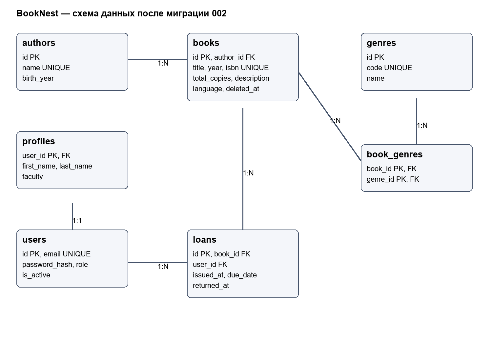

# База данных BookNest

Схема в третьей нормальной форме: автор хранится один раз, жанры вынесены в справочник, повторяющиеся пары запрещены составным ключом. Поля таблицы зависят от её ключа. Имя автора не копируется в books, e-mail не копируется в loans. Доступность вычисляется по активным выдачам, а не хранится отдельным несогласованным числом.

Исходник схемы: er.mmd. Часть A: schema.sql, seed.sql, queries.sql. Часть B: app/models.py и migrations. DDL описывает исходную ревизию 001; ревизия 002 добавляет language/deleted_at и заменяет full_name на first_name/last_name. Сравнение последней схемы и ORM выполнено командой alembic check: расхождений нет.

## Таблицы и ON DELETE
- authors → books: RESTRICT сохраняет связи, пока существуют книги автора.
- books ↔ genres: book_genres с составным первичным ключом; CASCADE удаляет только связи.
- users → profiles: общий ключ 1:1, CASCADE удаляет профиль вместе с пользователем.
- users/books → loans: RESTRICT сохраняет историю выдач; удаление книги в приложении мягкое.

## Запуск
На отдельной БД часть A выполняется: `psql -f db/schema.sql`, затем `psql -f db/seed.sql` и `psql -f db/queries.sql`. На БД приложения schema.sql не запускается: вместо него выполняется `.venv/Scripts/python -m alembic upgrade head`, затем `.venv/Scripts/python -m tools.seed`.

DATABASE_URL и TEST_DATABASE_URL задаются в .env, который не попадает в Git. Тестовая БД должна отличаться от рабочей и оканчиваться на _test.

## Проверенные результаты
SQL, три ошибки ограничений, откат двух операций и проверка дампа: docs/lab8/sql-results.txt. После восстановления: 30 книг и 20 выдач.
Нагрузочный набор: 500000 строк. B-tree: 68,771 → 0,111 мс, Parallel Seq Scan → Index Scan. GIN: 409,101 → 0,190 мс, Parallel Seq Scan → Bitmap Index Scan. Это отдельные локальные измерения, они не являются гарантией такого ускорения на любом сервере.

Устранение N+1: 26 SELECT → 3 SELECT на 20 книгах. До оптимизации identity map ограничивает число запросов авторов пятью, но жанры загружаются отдельно для каждой книги. После selectinload выполняются запросы книг, авторов и жанров.

Миграции: upgrade 001 → seed → upgrade head → downgrade 001 → upgrade head. Проверено сохранение имён, включая повторные и конечные пробелы. Две параллельные выдачи последнего экземпляра дали 201 и 409. Журнал: docs/lab8/migrations-results.txt.

## Практика 10 — три аномалии
В широкой таблице выдач переименование автора требует изменения многих строк (обновление); читателя без выдачи невозможно добавить, если ключ строки — выдача (вставка); удаление его последней выдачи теряет данные читателя (удаление). Разделение authors, users, books и loans устраняет эти зависимости.

## Индексы
books_author_year_idx соответствует фильтру автора и сортировке по году/id. loans_due_idx уменьшает набор для отчёта просроченных активных выдач. Частичный уникальный loans_active_uniq выражает правило одной активной выдачи книги читателю. books_search_idx поддерживает полнотекстовый поиск. Индексы увеличивают размер БД и стоимость записи, поэтому оцениваются по планам конкретных запросов.
